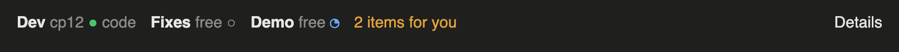
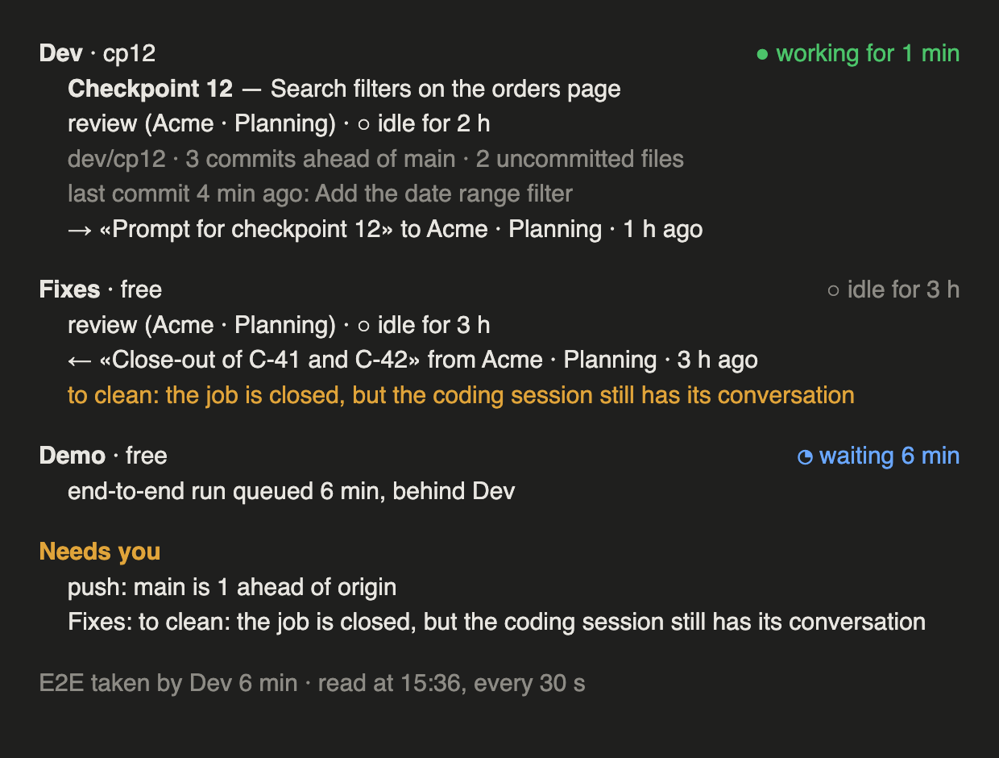

# metodo

**A review-and-build workflow for Claude Code: one reviewing session, several coding sessions in separate clones, and hooks that enforce the rules.**





*The line above the prompt and the panel opened by `/lanes-status`. Illustration with invented data, drawn with the mod's own texts.*

*Repository: `claude-lanes`. Plugin name: `metodo`.*

## The problem

- Long Claude Code sessions drift: the same run is repeated, work from two tasks ends up in one conversation, and a rule remembered in prose is forgotten after the next compaction.
- When several sessions work in parallel on one repo they overwrite each other, and a session killed for memory leaves background work nobody wakes up.
- metodo moves the rules out of memory and into hooks: they run whether or not anyone remembers.

## What you get

| Piece | What it does |
|---|---|
| **Guard** (`hooks/guard.py`, PreToolUse) | Blocks the commands you would regret: editing an already-applied migration, a `docker compose` that deletes volumes without naming its project, protected volumes, `prune -a`, a release from outside the main folder, a `git push` from a clone. In the cloud: a second job's prompt to the same coding session, and an archive before the close-out. |
| **Delivery gate** (`hooks/delivery.py`, Stop) | A «Delivery of…» report from a clone does not go out without the `delivery-check` sub-agent having run and the «Done» written. |
| **Start-up orientation** (`hooks/startup.sh`, SessionStart) | Prints branch, commit, tree state and distance from `origin/main` when a coding session opens. |
| **Lanes panel** (`/lanes-status`, status line) | One line above the prompt, and a panel: what each lane is doing, who holds the end-to-end lock, which sessions are to clean. |
| **Close-out cleanup** (`scripts/cleanup.sh`) | After a merge, deletes merged branches and the bench copies, containers, volumes and images of that job, found by name. Never touches protected things. |
| **Handoff protocol** (`metodo:handoffs`) | Prompt → Plan → Delivery → Close-out, between a reviewing session and a coding session, as messages with a recognizable first line. |
| **Decision log** (optional) | A record of the *why* of each decision, so sessions stop reopening settled choices. See below. |

The rules themselves are in [`METHOD.md`](METHOD.md) (what every session needs) and four skills, loaded only when a phase starts: `metodo:review`, `metodo:lanes`, `metodo:handoffs`, `metodo:design`.

## Install

```bash
claude plugin marketplace add andrearinaldi89-blip/claude-lanes && claude plugin install metodo@metodo
```

The plugin acts only in projects that have a `.claude/metodo.json`.

## Adopt it in a project

1. Copy [`templates/metodo.json`](templates/metodo.json) to `.claude/metodo.json` and fill it in ([fields](docs/configuration.md)). The prefix is short, lowercase and no other project's.
2. In the project's `CLAUDE.md`, right after the title, import the method from where the plugin is installed: `@<path-to-plugin>/METHOD.md`. Claude Code asks once to approve the external import; approve it.
3. From the main folder, run `<path-to-plugin>/scripts/clones.sh`: it creates one clone per lane inside the main folder and keeps the main `CLAUDE.md` out of them.
4. Create `docs/blocks/` from [`templates/block.md`](templates/block.md) and `docs/corrections.md`. If the project has an interface, add `docs/DESIGN.md` from [`templates/DESIGN.md`](templates/DESIGN.md).
5. Optional: start a decision log (below).

## What works where

| Piece | Needs | Terminal | Linux |
|---|---|---|---|
| `METHOD.md`, skills, templates | Claude Code (skills, `@import`) | yes | yes |
| Guard, delivery gate, start-up hook | Claude Code hooks, Python 3, `git` | **yes** | **yes** |
| `scripts/clones.sh` | `git`, `python3` | yes | yes |
| `scripts/cleanup.sh` | `git`, `docker`; `lockf` (macOS) with fallback to `flock` | yes | yes |
| `delivery-check` sub-agent | plugin sub-agents | yes | yes |
| **Messages between sessions** (`SendMessage`, `list_sessions`, `start_session`) | **Claude Code desktop** | no | no |
| **Lanes mod** (status line, `/lanes-status`, panel, auto `/clear`, dirty-session refusal) | Claude Code's mod API (not stable); the panel is desktop-only | to be verified | only if the desktop app runs |
| **Wake-up** of a coding session closed by the app | the desktop app's log (format not documented, may change) | no | no |
| **Cloud sessions** (`create_session`, `send_message`, `archive_session`; one coding session per job, archived at close-out) | Claude Code on the web (claude.ai/code) and its `claude-code-remote` tools | no | in the cloud |

In the cloud the coordination works differently: every session has its own container, so there are no clones and no panel; a coding session is opened for each job on its branch, the work goes through `origin`, and at close-out the session is archived instead of cleaned (`skills/handoffs/SKILL.md`, «In the cloud»). The guard, the delivery gate and the start-up hook recognize a cloud coding session by its lane branch.

Two levels, then: the **core** (hooks, skills, templates, scripts) works in a terminal and on Linux, because it is hooks, files and git. The **coordination between sessions** needs Claude Code desktop and, for now, macOS. The mod uses unstable APIs and may break with a Claude Code update.

## Why these rules

- **The handoff is the repository, not the chat.** A fact that is not in a document does not exist for the next session, and a chat does not survive compaction. So prompts, plans, deliveries and results live in files, and messages only point to them.
- **Review means trying to break, at each checkpoint.** Reading a safety rule and proving it are different things; correcting a foundation already built on means redoing, so review comes early and often, not at the end.
- **Every run runs once.** What costs is not the number of tests but the repetitions: whole chains rerun after a one-line fix, tests that already fail on `main` rerun to understand them. Run the area at delivery, the whole suite in CI, and rerun only what was red.
- **One lane, one folder.** Parallel sessions in one working tree overwrite each other. Separate clones, one merge point (the reviewer), one lock for the end-to-end stack.
- **One way to clean a session.** A cleanup that relies on a reviewer remembering works while there is one way to do it. With three ways, the reviewer follows the last one it remembers after each compaction, and several jobs end up in one conversation. So there is one way, and the mod refuses a prompt to a dirty session.
- **Mutations prove tests.** A test is believed only after it has been seen red against the specific thing it watches, on a throwaway copy, never on the working tree.
- **Applied files are not edited.** A migration that has run elsewhere is history: add a new one. The guard enforces what memory cannot.
- **Name everything with the project prefix and the job.** That is how cleanup finds a job's leftovers by itself, and how two projects do not get mixed up.
- **No copies of the method in projects.** A method copied into several projects diverges within days. One plugin; projects keep only their configuration and their own rules.

## The decision log (optional)

The method separates the **why** from the **what**: documents say what to build, the decision log says why it was decided that way. Without it, every new session (and every compaction) is a chance to reopen a choice that was settled for good reasons, or to quietly contradict it. With it, a session that meets something contradicting a decision stops and writes it down, and a decision changes only in one place, with its reasoning, where it can be read.

Two ways to keep it:

- **With an artifact.** Publish [`templates/decision-log.html`](templates/decision-log.html) as a claude.ai artifact with the `db` capability. You get a page with areas, entries (title, the issue, the recommendation, references), a status (open, discussion, closed), a place for the decision's minutes, and a comment thread; the reviewing session reads and writes it with `ArtifactData`. Put its address in `CLAUDE.md`.
- **Without one.** Keep `docs/decisions.md`: one section per decision, with an id (`A1`, `B3`), the issue, the decision and the reason. The rule is the same: the file is the *why*, the other documents the *what*.

Either way, it is optional: the rest of the method works without it.

## How the protocol works

Between a lane's reviewer and its coding session, every step is a message whose first line says what it is:

1. **Prompt for…** (reviewer → coding): the branch exists; the message points to a prompt file.
2. **Plan for…** (coding → reviewer): what changes, the test, the mutation that will show it red. No code until the ok.
3. **Delivery of…** (coding → reviewer): after `delivery-check`, with the real outputs of the runs. The delivery gate stops a delivery without the check and without the «Done».
4. The reviewer verifies by trying to break the work, then sends corrections or closes.
5. **Close-out of…** (reviewer → coding): after the «Verification», the merge and the cleanup. The mod clears the coding session; a new prompt is refused while the session is dirty. In the cloud the reviewer archives the coding session instead, with the owner's confirmation, and the next job gets a new one.

Details: [`skills/handoffs/SKILL.md`](skills/handoffs/SKILL.md).

## More

- [`docs/configuration.md`](docs/configuration.md): every field of `.claude/metodo.json`.
- [`docs/maintaining.md`](docs/maintaining.md): how the plugin is laid out and changed.
- [`CONTRIBUTING.md`](CONTRIBUTING.md), [`SECURITY.md`](SECURITY.md), [`README.it.md`](README.it.md) (short Italian translation of this file).

**Contact:** open a thread in this repository's GitHub Discussions, or see the owner's GitHub profile.

**License:** [MIT](LICENSE).
